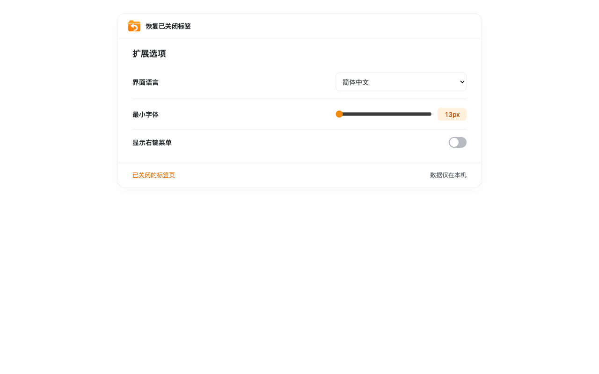

# Reopen History


**Current version: 1.0.0**

A small, local-only browser extension for recovering closed tabs. Built independently, with the one-click behavior of [Reopen closed tab Button™](https://microsoftedge.microsoft.com/addons/detail/reopen-closed-tab-button%E2%84%A2/ffikmgfojmfconjpbcflembkiclgfgeo) as a reference; no original code, assets or branding are included.

[简体中文说明](docs/README.zh-CN.md) · [Privacy](PRIVACY.md) · [Support](SUPPORT.md) · [Verification and limitations](docs/VERIFICATION.md)

Privacy and support pages are bundled for offline reading and generated for static hosting in docs/. See [store listing materials](docs/STORE-LISTING.md) for public URL setup and ready-to-use descriptions.

For the 1.0.0 release, see the [four-store publishing guide](docs/STORE-PUBLISHING.zh-CN.md). It includes upload file mappings, reviewer instructions, privacy/permission explanations and the local Safari App Store archive/export workflow.

## Downloads

Download all browser packages from [GitHub Releases](https://github.com/keman5/reopen-history/releases/latest) or the checked-in [1.0.0 packages and installation instructions](releases/1.0.0/README.md). Chrome and Edge share the Chromium ZIP. Firefox's ZIP is unsigned and supports temporary loading only. The Safari macOS host is an Apple Silicon development distribution, not an App Store or confirmed notarized package.

Builds also prepare versioned files in `releases/<version>/`. To package existing local 1.0.0 artifacts without incrementing the version, run `bash scripts/github-release/build.sh --from-existing --safari-app`. After committing and pushing the release files, append `--publish` to attach them to a new GitHub Release. Existing releases are never overwritten automatically.

## Screenshots

Actual screenshots of the extension running in Simplified Chinese.

**Closed-tab history** — search titles and URLs, view site icons and reopen a closed tab.


**Settings** — choose the interface language, adjust the minimum font size and toggle webpage context menus.



## Usage

- **Click the pinned toolbar button:** reopen the most recently closed tab or window.
- **Right-click the toolbar button → Closed tabs:** open `history.html` in a normal browser tab. No extra toolbar recovery item is added. The native extension-name item is controlled by the browser; no homepage override is set, allowing store installations to use the store listing. It may be disabled for locally loaded builds. Extension options can additionally enable webpage recovery/history menus (off by default).
- **Inside the history page:** click the orange button to reopen the latest entry; hold it for 500 ms to reveal the list. Escape hides the history list without closing the tab. Standard Tab, Enter and Space navigation is supported, without automatically focusing controls.
- **Keyboard:** `Alt+Shift+T` reopens the latest entry; `Ctrl+Shift+Y` opens history (`⌘+Shift+Y` on macOS). Browser or OS shortcuts may take precedence; change bindings in your browser's extension shortcuts settings.
- **Text size:** Settings includes a 13–20px minimum font-size slider. Changes apply immediately to all open history and settings pages and are saved locally; larger headings retain their size.

**Toolbar long press:** standard WebExtensions toolbar actions expose click events, not pointer-down/up events. A portable extension cannot distinguish a short click from a long hold on the native toolbar. The toolbar therefore keeps immediate one-click recovery; long press is implemented on the extension's own button. This tradeoff was explicitly selected for this project.

## Browser support

| Browser | Package | Recovery |
| --- | --- | --- |
| Chrome 120+, Edge 120+, Brave, Opera, Vivaldi | `~/downloads/dist/reopen-history-chromium-v1.0.0` | Native `sessions` restore, including browser-provided tab state |
| Firefox 142+ desktop | `~/downloads/dist/reopen-history-firefox-v1.0.0` | Native `sessions` restore |
| Safari 16+ on macOS 13+ | `~/downloads/dist/reopen-history-safari-v1.0.0` + generated macOS host app | Local URL recovery; see limitations below |

The history page uses one searchable list, marks the newest entry with a badge, and shows **100 entries per page**. All browsers retain up to **1,000 eligible entries locally**. Chrome/Edge/Firefox initially import at most 25 browser-provided sessions and accumulate additional closures while active; unavailable older sessions cannot be backfilled. Available sessions use native recovery; expired archived entries reopen their saved URL only (a window entry falls back to its first tab). Safari uses URL recovery throughout.

Only normal HTTP(S) pages are eligible; extension, blank, new-tab and browser-internal pages are excluded from history, badge counts and recovery. A closed window is shown as one entry only when every tab is eligible, because native restoration reopens the entire window. Mixed windows are skipped without deleting browser history. The Safari host app targets macOS 13 and newer.

Safari does not implement `sessions`. Its fallback begins recording after the extension is enabled, saves only normal HTTP(S) tab URLs, titles and pinned state, and excludes private/internal/file/data pages. It cannot restore form contents, scroll position, back/forward history, window grouping, or tabs closed while the extension is disabled or not running. iOS Safari and Firefox for Android are not supported by this release.

## Build and install

Requirements: Node.js 22+, `zip`, installed Microsoft Edge (headless icon rendering); Xcode for the Safari app. The extension bundles the MIT-licensed `tldts` public-suffix parser locally to derive registrable domains correctly (including `co.uk` and private hosting suffixes); it does not load runtime libraries from a CDN. Playwright is used only for development tests.

```sh
npm ci
bash build.sh --version 1.0.0
```

The script runs the core tests, validates every locale and produces unpacked builds plus ZIP files for all three targets. All output is written to `~/downloads/dist`. It replaces only this project's matching versioned output, preserves other projects' downloads, and clears this project's `.artifacts` and old local `dist` output; when Go is installed it also clears Go build/test caches as required by the workspace instructions.

The explicit version reproduces the 1.0.0 release. Omit `--version` to automatically increment the patch version for a new build.

**Chrome/Edge:** open `chrome://extensions` or `edge://extensions`, enable Developer mode, choose **Load unpacked**, and select `~/downloads/dist/reopen-history-chromium-v1.0.0` (expand `~` to your home directory). Pin the toolbar button. Other Chromium browsers use their corresponding extensions page.

**Firefox:** open `about:debugging#/runtime/this-firefox`, choose **Load Temporary Add-on**, then select `~/downloads/dist/reopen-history-firefox-v1.0.0/manifest.json` (removed on browser restart). Permanent installation requires Mozilla signing; a ZIP is not a signed XPI.

**Safari:**

```sh
bash build.sh --version 1.0.0 --safari
```

This generates a macOS Swift host using Apple's converter and compiles it locally with an ad-hoc signature by default. The app is placed in `~/downloads/dist/Reopen History.app`; temporary Xcode build caches are removed after packaging. For personal development, Safari may require Developer settings → Allow unsigned extensions. To sign with your own certificate and install/replace the local host app:

```sh
SAFARI_SIGN_IDENTITY='Developer ID Application: Your Name (TEAMID)' \
SAFARI_TEAM=TEAMID bash build.sh --version 1.0.0 --safari --install
```

The install option replaces `/Applications/Reopen History.app` after the new build passes signature verification; it does not enable the browser extension. Safari still requires explicit user activation. For normal distribution, sign the host and extension with your Apple Developer credentials and follow Apple's Safari distribution requirements. This project does not automatically change browser security settings or publish to any extension store.

## Development checks

```sh
npm test
npm run test:browser
npm run test:browser:safari
npm run test:firefox
```

The browser check runs installed Microsoft Edge **headlessly** in a disposable profile and serves test pages on localhost. It never touches your existing browser profile or foreground windows. It verifies actual native-session recovery, list ordering, 100-entry pagination, searching, short/long press, Escape, options persistence, invalid-page filtering, and safe rendering of untrusted titles. It invokes the toolbar's shared restore function headlessly; it does not prove a physical click on the native toolbar. Use `TEST_BROWSER=chromium` to test a separately installed Playwright Chromium build. The Safari fallback check runs its scripts in headless Edge with only the background manifest adapted; it does not verify Safari itself. The Firefox check uses `web-ext` from npm, an installed `/Applications/Firefox.app`, and a disposable extension/profile with a localhost-only result reporter.

## Site icons

History rows use a stable color and the registrable domain’s initial (for example, `docs.google.com` → G and `news.bbc.co.uk` → B). Chromium builds request `favicon` permission to display icons from the browser’s local `_favicon` cache. The browser may return its generic icon when a site icon is unavailable. Small inline raster icons exposed by browser tab/session metadata are retained with local history; invalid/failed images fall back to the letter. Remote favicon URLs are not fetched and no third-party favicon service receives browsing domains. Firefox/Safari use inline icons when available and otherwise the colored initial; existing records cannot gain an inline icon retroactively.

## Languages

English, 简体中文, 繁體中文, 日本語, 한국어, Deutsch, Français, Español, Português (Brasil), Italiano, Русский, العربية. Settings offers **Follow browser** (the default) or a manual language selection, saved locally. Changes update all open history/settings pages, relative dates, toolbar tooltips and context menus immediately. Arabic uses right-to-left layout; missing translations fall back to English. The name and command descriptions in the browser's extension-management UI remain controlled by the browser language. Every packaged locale must have the same complete set of keys.

## Permissions

- `favicon` (Chromium): read browser-cached site icons locally.
- `sessions` (Chromium/Firefox): list and restore the browser's closed sessions.
- `contextMenus`: toolbar history menu; optional webpage recovery/history menus are disabled by default.
- `storage`: local context-menu preference and up to 1,000 archived history entries; Safari also caches eligible open-tab metadata.
- `tabs`: Safari needs URLs and titles to track closed tabs; Chromium and Firefox also require this permission to display and search native session titles and URLs.

No content scripts, host permissions, remote favicons, telemetry, accounts or external network requests are used by the extension. Restoring a tab naturally loads its website. Browsing metadata is sensitive even when it stays local; see [PRIVACY.md](PRIVACY.md).

## License

MIT. This project is not affiliated with Microsoft or the author of the referenced extension.
