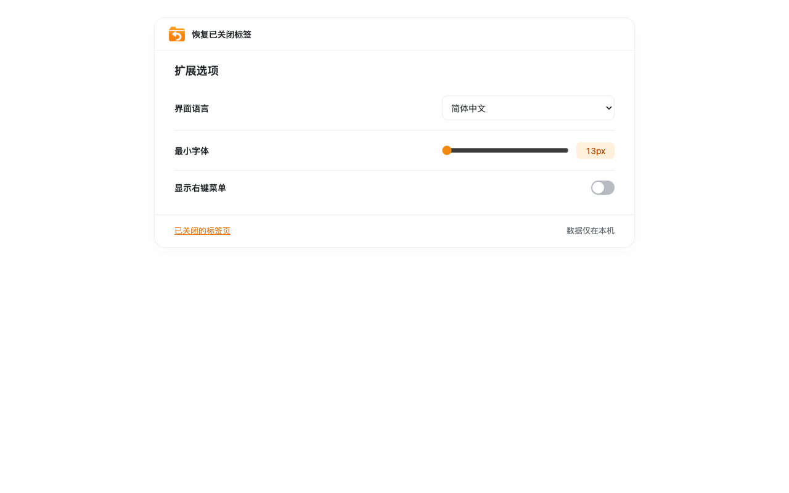

# Reopen History


**当前版本：1.0.0**

轻量的关闭标签页恢复扩展，支持 Chrome、Edge、Firefox，以及通过本地记录实现兼容的 macOS Safari。独立实现，不包含参考插件的源码、图标或品牌。

[English](../README.md) · [隐私说明](../PRIVACY.md) · [四个平台上架指南](STORE-PUBLISHING.zh-CN.md)

## 下载安装包

前往 [GitHub Releases](https://github.com/keman5/reopen-history/releases/latest) 下载，或在仓库的 [1.0.0 安装包目录](../releases/1.0.0/README.md) 获取同一批文件与安装说明。Chrome 和 Edge 共用 Chromium ZIP；Firefox ZIP 未经 Mozilla 签名，只能临时加载；Safari macOS 宿主为 Apple Silicon 开发分发包，不等同于 App Store 或已确认公证的安装包。

构建脚本会将附件和 SHA-256 校验值同步整理到 `releases/<版本>/`。复用本机现有产物：`bash scripts/github-release/build.sh --from-existing --safari-app`。提交并推送文件后，追加 `--publish` 发布 GitHub Release；不会自动覆盖已有 Release。

## 实际截图

以下为扩展简体中文界面的实际运行截图。

**关闭历史**：搜索标题或网址，查看站点图标，一键重新打开已关闭标签页。


**扩展选项**：切换界面语言、调整最小字号，开启或关闭网页右键菜单。



## 操作

- 固定工具栏按钮后，**单击直接恢复最近关闭的标签页或窗口**。
- **右键工具栏按钮 → 关闭历史**：在普通标签页打开 `history.html`，不额外添加工具栏恢复菜单项。顶部原生扩展名称项由浏览器控制；扩展不指定主页覆盖，让商店安装版本使用对应商店入口。本地加载版本可能显示为灰色。扩展选项可额外开启网页恢复／历史菜单，默认关闭。
- 历史页面中的橙色按钮：**单击恢复、长按 500 毫秒显示列表**；Esc 收起列表，保留历史页面。支持 Tab、Enter、空格，不主动抢焦点。
- 快捷键：`Alt+Shift+T` 恢复；`Ctrl+Shift+Y` 打开历史，macOS 为 `⌘+Shift+Y`。若冲突，请在浏览器的扩展快捷键设置中修改。
- 字号：设置页提供 **13–20px 最小字体滑轨**，拖动时实时更新所有已打开的历史页和设置页，并在本地保存；原本更大的标题保留字号。
- 语言：扩展选项可选择“跟随浏览器”或手动指定现有 12 种语言，偏好仅在本地保存。历史页、设置页、时间、工具栏提示及右键菜单即时切换；阿拉伯语自动使用从右到左布局。扩展管理页的名称和浏览器快捷键列表仍由浏览器语言决定。

浏览器扩展标准不提供原生工具栏按钮的按下／松开事件，因此无法跨浏览器可靠识别工具栏长按。本项目按确认的选择保留工具栏单击恢复，长按放在扩展页面内，并提供选项页、快捷键及工具栏右键菜单历史入口。

历史页面不显示大标题，所有记录合并为一个列表，仅最新一条带「刚刚关闭」标签。每页显示最多 **100 条**，支持上一页／下一页；搜索覆盖全部本地记录并回到第一页。所有浏览器最多保留 **1000 条** 本地记录，已有数据继续保留。原生接口已过期的记录只能重新打开保存的网址，无法恢复页面状态；过期窗口记录只能打开其第一个网址。扩展启用前、超出浏览器原生 25 条范围的旧记录无法补回。

## 兼容范围

| 浏览器 | 方式 | 限制 |
| --- | --- | --- |
| Chrome / Edge 120+、Brave、Opera、Vivaldi | 浏览器原生会话恢复 | 初次最多导入 25 个会话，随后本地积累至 1000 条；仍可用的窗口会话整体恢复 |
| 桌面 Firefox 142+ | 浏览器原生会话恢复 | 永久安装需要 Mozilla 签名；临时安装重启后失效 |
| macOS 13+ Safari 16+ | 本机记录后重新打开网址 | 只记录扩展启用后的普通网页，最多 1000 条；不能恢复页面状态、前进后退记录或窗口分组 |

所有浏览器仅恢复普通 HTTP(S) 网页，扩展页、空白页、新标签页及浏览器内部页面均不进入历史、计数和恢复候选。原生关闭窗口只有全部标签页有效时才显示；混有无效页的窗口整体跳过，避免批量恢复带回这些页面，不删除浏览器原始历史。

Safari 不记录隐私标签页和浏览器内部页面，不提供启用前的关闭历史。iOS Safari 和 Android Firefox 不在当前支持范围内。Safari 宿主应用最低支持 macOS 13。

## 构建与安装

在项目根目录执行：

```sh
npm ci
bash build.sh --version 1.0.0
```

所有构建产物固定输出到 `~/downloads/dist`，仅覆盖本项目同版本产物，保留其他项目文件。

指定 `--version 1.0.0` 可重新构建当前正式版；不传 `--version` 时，脚本会自动递增补丁版本号。

Chrome / Edge 在扩展管理页启用开发者模式，选择「加载解压缩的扩展」，载入 `~/downloads/dist/reopen-history-chromium-v1.0.0`。

Firefox 在 `about:debugging#/runtime/this-firefox` 点击「临时载入附加组件」，选择 `~/downloads/dist/reopen-history-firefox-v1.0.0/manifest.json`。

Safari：

```sh
bash build.sh --version 1.0.0 --safari
```

生成 Xcode 工程并本地编译 macOS 宿主应用，位于 `~/downloads/dist/Reopen History.app`。默认构建使用临时签名，未做分发签名，开发安装可能需要在 Safari 开发者设置允许未签名扩展；正式分发需要 Apple 开发者签名等步骤。可通过 `SAFARI_SIGN_IDENTITY` 和 `SAFARI_TEAM` 指定自己的签名，追加 `--install` 会替换 `/Applications/Reopen History.app`。构建完成后清理临时 Xcode 缓存。脚本不会自动修改浏览器安全设置、启用扩展，也不会提交商店。

所有测试均在后台执行。`npm run test:browser` 使用独立临时配置启动无头 Edge，不影响当前浏览器。各项实际验证边界见 [VERIFICATION.md](VERIFICATION.md)。

支持 12 种完整界面语言，默认跟随浏览器，也可在扩展选项中手动切换。数据仅保存在本机，无账号、无统计、无远程图标请求；打开网页本身仍会访问对应网站。详见 [隐私说明](../PRIVACY.md)。


## 历史记录图标

每条记录使用主域名首字母和固定配色，例如 `docs.google.com` → G、`news.bbc.co.uk` → B。主域名通过随包附带的 `tldts` 公共后缀解析器计算。Chrome／Edge 使用 `favicon` 权限读取浏览器本地站点图标缓存；浏览器未缓存时可能返回通用图标。浏览器提供的小型内嵌位图会随本地历史记录保留，图片加载失败则回退字母。Firefox／Safari 无可用内嵌图标时显示字母。不会请求第三方图标服务或远程图标网址。
